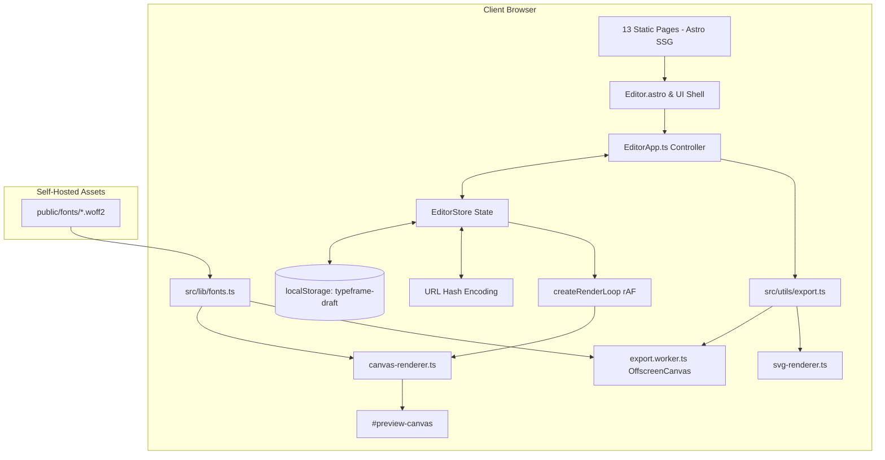

# Typeframe — Architecture & Technical Audit

**Project:** Typeframe (typographic studio for shareable images)  
**Version:** 0.0.1  
**Audit date:** November 2026  
**Stack:** Astro 6 · TypeScript (strict) · Vanilla CSS (design tokens) · Canvas 2D · Vector SVG export · Vitest  

---

## 1. Executive summary

Typeframe is a **client-only static web application** that turns quotes, notes, and code snippets into publication-grade editorial graphics. Astro generates 13 static pages (the home studio, 8 category-tailored studio landing pages, and 4 editorial prose pages). A lightweight client script (`EditorApp.ts`) manages the studio interface, live preview loop, and client-side rendering. There is **no backend server**, **no database**, **no user account system**, and **no third-party tracking scripts**.

| Area | Status | Notes |
|------|--------|-------|
| Architecture clarity | Excellent | Clear unidirectional pipeline: DOM inputs → `EditorStore` → rAF loop → Canvas/SVG renderers |
| Production readiness | Complete | Multi-format raster worker export (PNG, WebP, JPEG at 1×–4×) + standalone SVG export |
| Performance | Excellent | 100% self-hosted variable WOFF2 fonts; no Google Fonts requests; rAF-throttled canvas rendering; CSS tokens |
| Security & Privacy | Zero risk | 100% local client execution; drafts stored in `localStorage` or URL hash; no telemetry or ad scripts |
| Test coverage | Good | Vitest suite (6 test files, 27 tests passing) covering scale, SVG snapshots, layout, text parsing, and URL state |
| Accessibility | Good | Live screen-reader updates via `#sr-preview-description`, strict `<label>` bindings, visible focus states, ARIA tabs |
| Responsive Layout | Excellent | 3-pane desktop layout collapses to tabbed mobile studio (`Write` / `Artboard` / `Style`); zero horizontal overflow (390px mobile viewport verified) |

---

## 2. System context



**Deployment model:** `astro build` generates an entirely static `dist/` directory deployed to Cloudflare Pages, Netlify, Vercel, or any CDN.

---

## 3. Technology stack

| Layer | Choice | Details |
|-------|--------|---------|
| Framework | Astro 6 | Static site generation (`output: "static"`), 13 pre-rendered routes, sitemap integration |
| Language | TypeScript 5 | Strict mode (`tsconfig.json`), no unchecked index access, explicit type safety |
| Styling | Modern CSS | Design tokens (`tokens.css`), reset (`global.css`), editor layout (`editor.css`), editorial prose (`pages.css`) |
| Font Assets | Variable WOFF2 | 7 self-hosted families in `public/fonts/` (Instrument Serif, Source Serif 4, Playfair Display, Cormorant Garamond, Inter, IBM Plex Sans, JetBrains Mono) |
| Rendering | Canvas 2D API | High-DPI canvas preview loop with variable font scaling, grain, and decorative rules |
| Vector Export | Native SVG | Clean vector SVG markup with CSS styling, embedded fonts, and exact color matching |
| State | Pub/Sub Store | Custom `EditorStore` with undo/redo capability, draft persistence, and URL state hashing |
| Concurrency | Web Worker | OffscreenCanvas worker for asynchronous 1×–4× raster export without UI jank |
| Testing | Vitest | 27 tests across 6 suites, including SVG snapshot regression verification |

---

## 4. Repository structure & page system

```
typeframe/
├── astro.config.mjs         # Static SSG config, HTML minification, sitemap plugin
├── package.json             # Scripts: dev, build, preview, check, test
├── tsconfig.json            # Strict TypeScript configuration
├── public/
│   ├── favicon.svg          # SVG brand icon
│   └── fonts/               # 7 self-hosted variable WOFF2 font families
├── docs/
│   └── ARCHITECTURE-AUDIT.md # This audit document
├── src/
│   ├── components/
│   │   ├── Editor.astro     # Studio editor markup, toolbar, collapsible panels, mobile tabs
│   │   ├── EditorApp.ts     # Studio client controller, interaction listeners, font management
│   │   ├── Footer.astro     # Hairline editorial footer with legal/internal links
│   │   └── ToolDirectory.astro # Cross-tool directory matrix for SEO and discovery
│   ├── data/
│   │   ├── tools.ts         # 8 studio tool configurations, metadata, headlines, FAQs
│   │   └── home-faqs.ts     # Homepage FAQ content model
│   ├── layouts/
│   │   └── BaseLayout.astro # Base HTML shell, SEO/social meta, JSON-LD graphs, font preloads
│   ├── lib/
│   │   ├── auto-layout.ts   # Geometry calculation for text and code blocks
│   │   ├── backgrounds.ts   # Solid, gradient, mesh, glass, grain, and photo backdrops
│   │   ├── canvas-renderer.ts # Main canvas drawing engine (studio preview and export)
│   │   ├── fonts.ts         # Font loading orchestration via FontFace API
│   │   ├── preview-scale.ts # Mathematical viewport artboard scaling
│   │   ├── state.ts         # Reactive state container with draft storage integration
│   │   ├── svg-renderer.ts  # Scalable vector graphics export generator
│   │   ├── theme-decorations.ts # Studio accent rules, vignettes, and frame borders
│   │   ├── themes.ts        # Editorial themes (Studio Dark, Kinfolk, Manuscript, etc.)
│   │   └── typography.ts    # Typographic configuration and line measurement
│   ├── pages/
│   │   ├── index.astro      # Homepage: studio + editorial guide + format specs + FAQ
│   │   ├── about.astro      # About Typeframe: philosophy, typefaces, architecture
│   │   ├── contact.astro    # Direct contact, issue reporting guide, FAQs
│   │   ├── privacy-policy.astro # Explicit zero-data collection privacy policy
│   │   ├── terms.astro      # Transparent terms of service and font licensing
│   │   └── tools/
│   │       └── [slug].astro # Dynamic studio landing pages for 8 specific use cases
│   ├── styles/
│   │   ├── tokens.css       # Color palette, spacing, type scales, easing curves
│   │   ├── global.css       # Reset, base typography, and focus ring definitions
│   │   ├── editor.css       # 3-column studio layout, responsive mobile tabs, controls
│   │   └── pages.css        # Editorial prose layout, numbered capability lists, FAQ accordions
│   ├── utils/
│   │   ├── export.ts        # Image export orchestration (worker + fallback)
│   │   ├── text-parser.ts   # Plain text, markdown, and code block formatting
│   │   └── url-state.ts     # URL hash state serialization and hydration
│   └── workers/
│       └── export.worker.ts # OffscreenCanvas web worker for export generation
```

### Static Page System (13 Pages)

1. **Homepage (`/`)**: Main interactive studio with pre-loaded quote card preset, editorial showcase, typography guide, format reference, and structured FAQ schema.
2. **Dedicated Tool Studios (`/tools/[slug]/`)**: 8 specialized pre-configured studio entrypoints:
   - `/tools/quote-card-maker/` (Quote cards)
   - `/tools/code-to-image/` (Formatted code cards)
   - `/tools/apple-notes-quote-generator/` (Notes style quotes)
   - `/tools/tweet-to-image/` (Social snippet cards)
   - `/tools/markdown-to-image/` (Formatted markdown text)
   - `/tools/linkedin-post-generator/` (Editorial landscape ratio)
   - `/tools/instagram-story-generator/` (9:16 vertical ratio)
   - `/tools/study-notes-card/` (Annotated reading cards)
3. **Editorial Prose (`/about/`, `/contact/`, `/privacy-policy/`, `/terms/`)**: High-contrast, authentic prose pages built with hairline borders and serif typography.

---

## 5. State management & persistence

### 5.1 Local Persistence (`localStorage`)
The active composition is automatically serialized and saved to `localStorage.getItem('typeframe-draft')`. When returning to the studio, the user's latest draft (text, typography settings, backdrop, and theme) is seamlessly restored without requiring an account.

### 5.2 URL Hash Sharing
Drafts can also be shared via URL hash fragments (`#state=...`). The state payload is compressed into base64 URL-safe strings:
- Opening a shared link hydrates the editor with the exact card parameters.
- If no valid URL state or local draft is present, the editor loads clean template defaults from `toolsData` or default presets.

---

## 6. Rendering pipeline & typography

### 6.1 Font Architecture
All font families are self-hosted in `public/fonts/` as variable WOFF2 files:
- **No external Google Fonts CDN** calls occur during page load or export.
- Fonts are loaded on demand via `src/lib/fonts.ts` using `document.fonts.load`.
- The Web Worker (`src/workers/export.worker.ts`) inspects the active draft and imports only the required font assets into `self.fonts` via `FontFace`, optimizing worker memory and export speed.

### 6.2 Canvas Rendering
The Canvas 2D engine executes the following draw order:
1. Canvas buffer initialization at target scale (`devicePixelRatio` for preview, 1×/2×/4× for export).
2. Surface fill: Solid, gradient, algorithmic mesh, frosted glass, or user photo.
3. Algorithmic grain/noise overlay (pre-calculated buffer).
4. Theme decorations (editorial hairline border, corner brackets, accent bars, or subtle vignettes).
5. Typographic text layout: Word-wrapped paragraphs, author attribution, or syntax-highlighted code lines.

### 6.3 Vector SVG Parity
`src/lib/svg-renderer.ts` produces clean vector XML strings mirroring canvas typography, colors, and borders, verified by snapshot tests against regression.

---

## 7. Responsive design & mobile craftsmanship

### Mobile Studio Experience (≤900px)
- **Tabbed Studio Navigation**: Rather than squeezing controls onto a small screen, the interface provides a sticky 3-tab controller:
  - **Write**: Text input, text mode selection, and layout templates.
  - **Artboard**: Live centered canvas preview with zoom and pan shortcuts.
  - **Style**: Typography sliders, color swatches, backdrop gallery, and export options.
- **Header Actions**: Quick export cluster (format dropdown + export trigger) remains pinned in the header for fast access.
- **Zero Horizontal Overflow**: All grid containers (`.template-grid`, `.theme-grid`, `.field--row`, `.author-name-row`, `.align-bar`, `.frame-style-grid`) enforce `minmax(0, 1fr)` tracks to prevent flex/grid expansion. Verified at 390px mobile viewport (`body.scrollWidth == 390px`).

---

## 8. Test suite & verification

Typeframe includes unit, layout, and snapshot regression tests powered by **Vitest**:

```bash
npx vitest run
```

### Test Coverage Summary:
- `src/lib/preview-scale.test.ts`: Artboard viewport fitting and scale caps.
- `src/lib/svg-renderer.test.ts`: SVG generation, XML escaping, and snapshot parity.
- `src/utils/url-state.test.ts`: URL hash serialization, deserialization, and corrupt-state recovery.
- `src/lib/auto-layout.test.ts`: Text block geometry and coordinate positioning.
- `src/lib/typography.test.ts`: Font stack resolution, line-height calculations, and metric bounds.
- `src/utils/text-parser.test.ts`: Markdown stripping, code token parsing, and quote parsing.

### Continuous Checks:
- `npm run check`: Executes `astro check && tsc --noEmit` across all 42 source files (0 errors, 0 warnings).
- `npm run build`: Generates all 13 static pages, verifying internal links, image assets, and sitemaps.

---

## 9. Security, privacy & compliance

- **No Data Ingestion**: All rendering is computed strictly inside the user's browser runtime. No text, image, or design state is ever transmitted over the network.
- **No Third-Party Trackers**: Zero tracking cookies, analytics pixels, or advertisement scripts (`ads.txt` removed).
- **Sanitized Vector Output**: SVG generation strictly escapes XML entities (`escapeXml`) to prevent SVG injection vectors.
- **Resource Hygiene**: Blob URLs created during photo uploads are tracked and revoked upon canvas re-render or replacement.

---

*Audit updated November 2026 for Typeframe 0.0.1 production release.*
